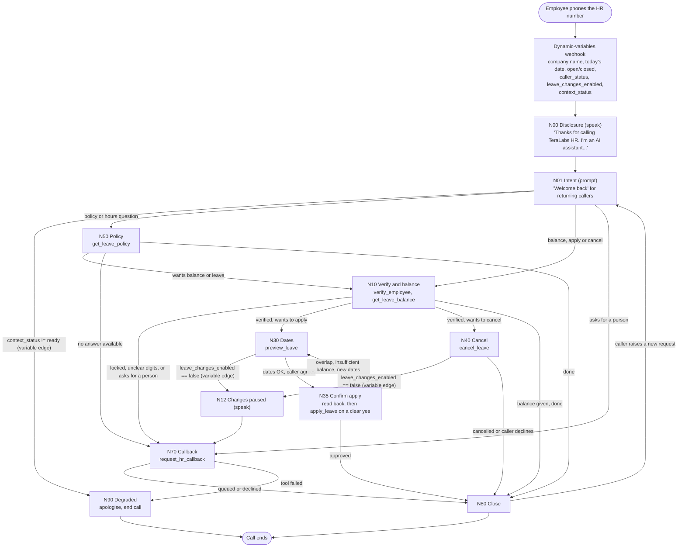
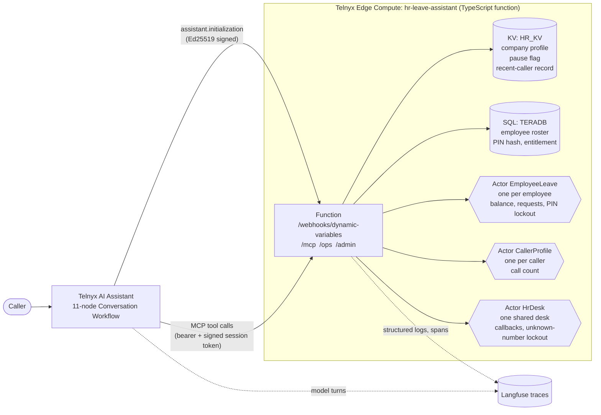
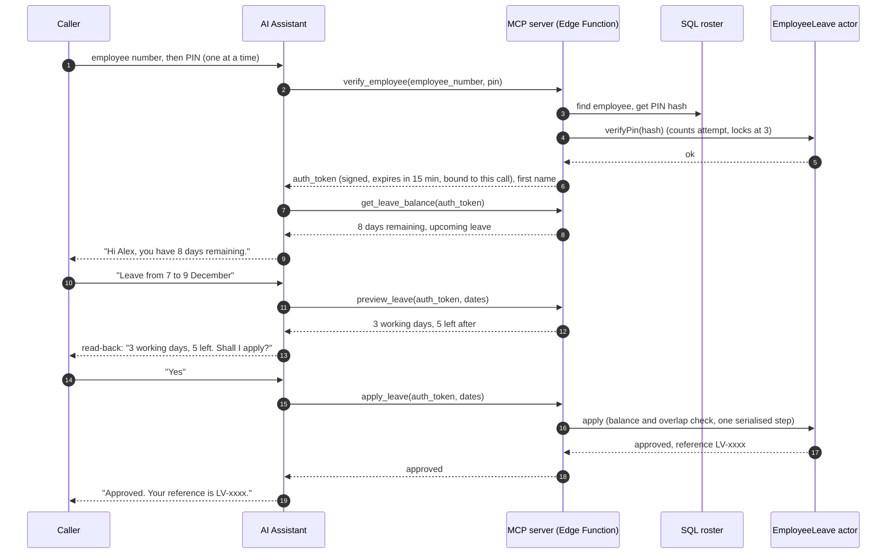

# TeraLabs HR Leave Assistant

An AI phone assistant for the HR desk of **TeraLabs Inc.** (a fictional company). An employee calls, signs in with a four-digit employee number and a four-digit PIN, hears their annual leave balance, and can apply for or cancel leave by voice. Callers who are not signed in can still ask leave-policy questions or ask for an HR callback.

Built for the Telnyx coding challenge on **Telnyx AI Assistants** (Conversation Workflow, dynamic-variables webhook, custom MCP server) and **Telnyx Edge Compute** (a TypeScript function, KV, SQL, and Stateful Actors).

| | |
| --- | --- |
| Company | TeraLabs Inc. (synthetic), HR desk Monday to Friday, 9 AM to 5 PM Eastern Time |
| Leave rules | 14 days annual leave per leave year (1 Jul 2026 to 30 Jun 2027); Monday to Friday only; 26 Nov 2026, 25 Dec 2026 and 1 Jan 2027 do not count; at least one day's notice; up to 10 working days per request; annual leave within the balance is approved immediately |
| Live function | `https://hr-leave-assistant-903aedd3-9.telnyxcompute.com` |
| Phone number | **`<TeraLabs HR number: fill in before submission>`** (not recorded in this repository) |
| Checks at last run | `npm run typecheck` clean; `npm test` 158 tests in 16 files pass (2026-11-18) |

> All data is synthetic. Never use real employee data or real PINs with this project.

---

## 1. What the assistant can do

| Caller says | What happens | Sign-in needed |
| --- | --- | --- |
| "What is my leave balance?" | Reads back days remaining and any upcoming approved leave | Yes |
| "I'd like to take leave from 7 to 9 December." | Counts working days, reads the request back, applies only after a clear "yes", speaks a reference such as `LV-7K2M` | Yes |
| "Cancel my leave starting 7 December." | Reads it back, cancels after a clear "yes", restores the days | Yes |
| "How much leave do I get?" / "What are your hours?" | Answers from the approved policy | No |
| "Can I speak to someone?" | Takes name, call-back number and reason, speaks a callback reference | No |
| Wrong PIN three times | Locks that employee for 15 minutes and offers an HR callback | n/a |

Leave changes can be paused by an operator without a redeploy. The assistant then still gives balances but says changes are paused and offers a callback.

## 2. Flow diagram

### 2.1 Call journey



Routing rule used throughout: a **variable edge** where the answer is a fact the backend already knows (context loaded, changes paused), because it cannot be misheard; an **LLM edge** where the answer is what the caller means. N00 and N12 are speak nodes because their wording must be delivered word for word.

### 2.2 System architecture



### 2.3 Sign-in and a leave request



## 3. How it is built

**Edge function** (`hr-leave-assistant/src/`): one TypeScript application serving
- `POST /webhooks/dynamic-variables` — runs at call start, verifies the Telnyx Ed25519 signature, and returns the variables the workflow routes on (it never reads employee data);
- `POST /mcp` — a seven-tool MCP server behind a bearer token;
- `/health/*`, `/ops/check` (dependency check) and `/admin/*` (requests, callbacks, stats, reset, seed-employees), the last two behind a separate operator bearer.

**The seven MCP tools**

| Tool | Purpose |
| --- | --- |
| `get_leave_policy` | Approved policy answers: entitlement, notice, carry-over, holidays, process, hours |
| `verify_employee` | The only tool that takes an employee number. Checks number and PIN, returns a signed session token |
| `get_leave_balance` | Entitlement, used, remaining, upcoming leave |
| `preview_leave` | Validates dates, counts working days, checks balance and overlap. Changes nothing |
| `apply_leave` | Rechecks everything, reserves the days, returns a reference. A repeat of the same request returns the same reference |
| `cancel_leave` | Cancels approved leave that has not started; a repeat restores nothing twice |
| `request_hr_callback` | Saves a callback request and returns a `CB-` reference |

**Which Telnyx primitive owns what** (and why)

| State | Primitive | Reason |
| --- | --- | --- |
| Leave balance, requests, overlap check, PIN attempts and lockout, outcome counters | `EmployeeLeave` actor, one per employee | "Enough balance? No overlap? Then reserve" must be one serialised step. Twenty simultaneous requests for five remaining days produce exactly five approvals |
| Per-caller call count | `CallerProfile` actor | A read-modify-write; KV has no compare-and-set |
| Callback requests; lockout for numbers not on the roster | `HrDesk` actor | A desk-level entity; unknown numbers must lock exactly like real ones so lockout does not reveal who exists |
| Company profile and policy text, pause flag `flags/leave_changes_enabled`, recent-caller record | KV | Read-heavy, rarely written, slightly stale is harmless, editable without redeploy |
| Employee roster (number, name, entitlement, PIN hash) | SQL (`TERADB`) | Must be readable and editable across all employees by an operator |
| Signature check, session token, date and policy rules | Plain function logic | Stateless |

Deliberately **not** in KV: anything that decides whether a balance suffices, whether leave overlaps, or whether a PIN attempt is allowed. Design detail: [docs/TDD.md](docs/TDD.md) §3.1.

**Security floor**
- No tool after sign-in accepts an employee number. Identity comes from a signed, expiring (15 minute) session token bound to the conversation.
- PINs are stored only as an HMAC, compared in constant time, never spoken by the assistant, and never logged.
- Three wrong PINs lock the employee for 15 minutes. An unknown number and a wrong PIN answer identically (same wording and countdown).
- Logs hold pseudonyms (first 8 hex characters of an HMAC), never a raw phone number, employee number, PIN, name, token or request body.
- `/mcp` and `/admin` fail closed without their bearer; the webhook fails closed on a bad signature.

**Observability**: one structured JSON log line per request (`telnyx-edge logs hr-leave-assistant --json`), `/ops/check` for dependency health, a `call_ref` that joins a call across log lines, and best-effort Langfuse tracing. See [tech_support.md](tech_support.md) for log queries.

## 4. Test it step by step

### 4.1 Test accounts (synthetic)

| Employee number | Name | PIN | Days used before today | Days remaining | Use it to test |
| --- | --- | --- | --- | --- | --- |
| **1001** | Alex | **1111** | 6 | **8** | The main journey: balance, apply, cancel |
| 1002 | Priya | 2222 | 12 | 2 | Insufficient balance |
| 1003 | Sam | 3333 | 9 | 5 | Spending the last days |
| 1004 | Jordan | 4444 | 0 | 14 | Lockout (deliberately enter wrong PINs) |

Start with **1001 / PIN 1111**. These accounts live in [`hr-leave-assistant/src/config/default-employees.ts`](hr-leave-assistant/src/config/default-employees.ts).

Test state is **shared**. Anyone who calls can spend employee 1001's balance or lock the account for 15 minutes. Reset before each test run (step 0).

### 4.2 Step 0: reset the test data (operator, one time per run)

The opening balances above (6, 12, 9 and 0 days used) are applied by the reset. Without a reset, an employee who has never been seeded shows the full 14 days.

```bash
export BASE="https://hr-leave-assistant-903aedd3-9.telnyxcompute.com"
export OPS_TOKEN="<operator bearer, the Edge secret HRLEAVE_OPS_TOKEN>"

curl -s -X POST "$BASE/admin/reset" -H "Authorization: Bearer $OPS_TOKEN"
# expected: {"status":"reset"}
```

If this is the first time on a fresh database, also run `POST $BASE/admin/seed-employees` with the same header, then reset again.

### 4.3 Step 1: test by phone (the real experience)

Call **`<TeraLabs HR number>`**. Speak digits one at a time. Dates in the examples assume today is mid-November 2026; use any Monday to Friday range at least one day away inside the leave year.

**Journey A: balance, apply, cancel (employee 1001)**

1. You hear the disclosure: "Thanks for calling TeraLabs HR. I'm an AI assistant..."
2. Say: **"I'd like to check my leave balance."**
3. When asked, say the employee number: **"one, zero, zero, one."**
4. When asked, say the PIN: **"one, one, one, one."** The assistant never repeats the PIN.
5. Expected: "Hi Alex" and **8 days remaining**.
6. Say: **"I'd like to apply for leave from December 7 to December 9."**
7. Expected read-back: **3 working days, 5 days left afterwards**. The assistant waits for a clear yes.
8. Say: **"Yes."** Expected: approved, with a reference like `LV-XXXX`. Write it down.
9. Hang up and **call again from the same phone**. Expected: it begins with **"Welcome back."**
10. Sign in again (1001 / 1111), say **"Cancel my leave starting December 7."** Confirm the read-back with **"Yes."**
11. Expected: cancelled, 3 days restored, **8 days remaining** again.

**Journey B: other scenarios**

| Scenario | What to do | Expected |
| --- | --- | --- |
| Policy question, no sign-in | Ask "How much annual leave do I get?" or "What are your HR hours?" | Approved answer (14 days; Mon to Fri, 9 to 5 Eastern) without asking who you are |
| Correct before confirming | At the read-back, say "No, make it December 8 to 9" | Old dates are not applied; a new read-back follows |
| Say no | At the read-back, say "No" | Nothing is applied; balance unchanged |
| Insufficient balance | Sign in as **1002 / 2222** and request 3 working days | Refused (only 2 days remaining), nothing changes |
| Lockout | Sign in as **1004** and give a wrong PIN three times | Locked for 15 minutes, HR callback offered. Even the correct PIN 4444 is refused until the lock expires (or the operator resets) |
| Ask for a person | Say "Can I speak to someone from HR?" | Takes name, number and reason; speaks a `CB-` reference |
| Changes paused | Operator runs `telnyx-edge storage kv key put 1b0b0a50-c921-498d-9916-ec3f085da147 flags/leave_changes_enabled false`, then call and try to apply | Fixed notice that changes are paused, callback offered; balance still works. Set it back to `true` afterwards |

### 4.4 Step 2: verify what the call did (operator)

```bash
# Leave requests per employee: the new LV- request, balances, status
curl -s "$BASE/admin/requests"  -H "Authorization: Bearer $OPS_TOKEN"

# Callback requests saved by the assistant
curl -s "$BASE/admin/callbacks" -H "Authorization: Bearer $OPS_TOKEN"

# Outcome counters (verified, auth failures, lockouts, approved, cancelled...)
curl -s "$BASE/admin/stats"     -H "Authorization: Bearer $OPS_TOKEN"

# Live structured logs while you call
telnyx-edge logs hr-leave-assistant --tail --json
```

In the logs, look for `tool: "verify_employee"`, `get_leave_balance`, `apply_leave` with `outcome: "approved"`, and `cancel_leave` with `outcome: "cancelled"`. No PIN, employee number or token appears in any line.

### 4.5 Step 3: test without a phone (HTTP, for graders and CI)

Health and access control:

```bash
curl -s "$BASE/health/liveness"                              # 200
curl -s -o /dev/null -w "%{http_code}\n" -X POST "$BASE/mcp" # 401, no bearer
curl -s -o /dev/null -w "%{http_code}\n" "$BASE/ops/check"   # 401, no bearer
```

The same sequence the assistant performs, against the MCP endpoint (use one conversation ID for every call; the session token is bound to it):

```bash
export MCP_BEARER="<MCP bearer, the Edge secret HRLEAVE_MCP_BEARER>"
call() {  # usage: call <id> <tool> '<arguments json>'
  curl -s -X POST "$BASE/mcp" \
    -H "Authorization: Bearer $MCP_BEARER" \
    -H "Content-Type: application/json" \
    -H "Accept: application/json, text/event-stream" \
    -d "{\"jsonrpc\":\"2.0\",\"id\":$1,\"method\":\"tools/call\",\"params\":{\"name\":\"$2\",\"arguments\":$3,\"_meta\":{\"telnyx_conversation_id\":\"conv_readme_001\"}}}"
}

call 1 get_leave_policy   '{"topic":"entitlement"}'
call 2 verify_employee    '{"employee_number":"1001","pin":"1111"}'   # returns auth_token
export TOKEN="<paste auth_token from the previous result>"
call 3 get_leave_balance  "{\"auth_token\":\"$TOKEN\"}"               # 8 days remaining after a reset
call 4 preview_leave      "{\"auth_token\":\"$TOKEN\",\"start_date\":\"2026-12-07\",\"end_date\":\"2026-12-09\"}"
call 5 apply_leave        "{\"auth_token\":\"$TOKEN\",\"start_date\":\"2026-12-07\",\"end_date\":\"2026-12-09\"}"
call 6 cancel_leave       "{\"auth_token\":\"$TOKEN\",\"start_date\":\"2026-12-07\"}"
```

Negative checks that should hold:
- `verify_employee` with a wrong PIN returns `auth_failed` with `attempts_left` counting down 2, 1, 0, then `locked`. An employee number that does not exist returns the same answers.
- Any employee tool with a missing, altered, or other-conversation token returns `unauthenticated` and touches nothing.
- Repeating `apply_leave` with the same dates returns the same reference and one request.
- `scripts/smoke.sh` in `hr-leave-assistant/` runs the deployed health and access checks.

### 4.6 Step 4: run the unit tests

```bash
cd hr-leave-assistant
npm install
npm run typecheck
npm test        # 158 tests in 16 files at the last run
```

## 5. Known limitations

- A spoken four-digit PIN is demo-grade identity and passes through the speech and language models. A production version would send a one-time code to a registered mobile through Telnyx Verify.
- Test state is shared and global; reset it with `POST /admin/reset` before an evaluation.
- Annual leave only, whole days, one company time zone, no manager approval, no carry-over handling (the assistant refers callers to HR).
- Telnyx platform behaviours that depend on the live account (for example Langfuse trace arrival and whether a spoken PIN is redacted in traces) are tracked as checks in [docs/TDD.md](docs/TDD.md) §13 and recorded in [docs/DEVLOG.md](docs/DEVLOG.md).

## 6. Repository layout

| Path | Contents |
| --- | --- |
| `hr-leave-assistant/` | The solution: `src/` (function, tools, actors, domain rules), `sql/`, `tests/`, `scripts/`, `telnyx.toml` |
| `docs/PRD.md`, `docs/TDD.md` | Product requirements and technical design, with acceptance scenarios A-01 to A-20 |
| `docs/MCP_SERVER_SPEC.md` | Build spec for the `/mcp` route |
| `docs/DEVLOG.md` | Every build session and review, with the model ID used |
| `docs/incidents/` | Incident records for real bugs (for example the session-token handoff bug) |
| `docs/GRADING_MAP.md` | Challenge criteria mapped to evidence |
| `tech_support.md` | Operator runbook: deploy, secrets, logs, metrics |
| `.opencode/opencode.json` | OpenCode with the Telnyx plugin (provenance requirement) |
| `AGENTS.md`, `CLAUDE.md` | Rules for the coding agent and the reviewer |

## 7. How it was built

The solution code was written with the **OpenCode** coding agent and the `@telnyx/opencode` plugin on a Telnyx-hosted model (Kimi-K2.6, recorded per session in [docs/DEVLOG.md](docs/DEVLOG.md)), as the challenge requires. **Claude Code** reviewed each committed slice against the design and wrote the planning documents. Two small pieces of solution code were written by Claude Code at the developer's explicit request (comment edits on 2026-11-12 and the token-handoff fix #34 on 2026-11-14); both are disclosed as exceptions in the DEVLOG. Each build session and review is a DEVLOG entry.
