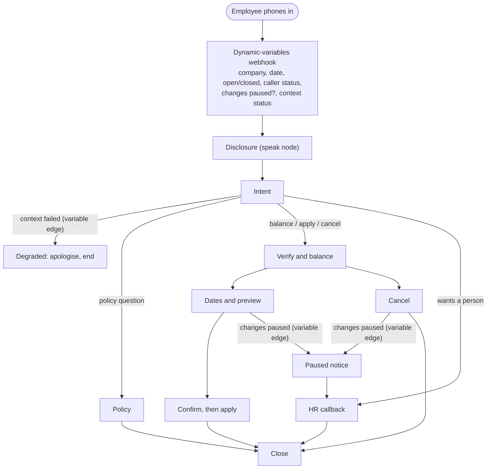

# TeraLabs AI Assistant: Project Summary (HR and Finance)

Prepared 2026-11-18 from the repository at branch `docs/75-readme-phone-number`. Every claim below comes from a source file, a test run, or a recorded incident. Where something is only configured or never observed, the text says so.

> **In one sentence:** the TeraLabs AI Assistant is a voice assistant for the fictional company TeraLabs Inc. An employee phones in, proves who they are, and gets HR help. **HR is built and tested end to end. Finance is so far a transfer route in the assistant's workflow, with no Finance backend.** There is a lot of room to improve it and to build on it, listed in section 6.

---

## 1. Overview

| | |
| --- | --- |
| What it is | An AI phone assistant for the HR and Finance desks of TeraLabs Inc. (a fictional company; all data is synthetic) |
| Who uses it | Employees, by phone |
| Phone number | `+1 253 294 7206` (test line) |
| Live function | `https://hr-leave-assistant-903aedd3-9.telnyxcompute.com` |
| Platform | Telnyx AI Assistants (Conversation Workflow, dynamic-variables webhook, custom MCP server) and Telnyx Edge Compute (TypeScript function, KV, SQL, Stateful Actors) |
| Origin | Telnyx coding challenge. It began as an appointment receptionist and was changed on 2026-11-12 to an HR leave assistant |
| Build provenance | Solution code was written by the OpenCode agent on a Telnyx-hosted model (Kimi-K2.6). Claude Code reviewed each slice and wrote the planning documents. Two small Claude-authored code changes are disclosed in the DEVLOG as exceptions |

## 2. The two departments

### 2.1 HR: built

An employee signs in with a four-digit employee number and a four-digit PIN, then can:

| Caller says | What happens |
| --- | --- |
| "What is my leave balance?" | Days remaining and upcoming approved leave are read back |
| "I'd like leave from 7 to 9 December" | The system counts the working days, reads the request back, and applies it only after a clear "yes". A reference such as `LV-XXXX` is spoken |
| "Cancel my leave starting 7 December" | Read-back, then cancel on a clear "yes". The days return to the balance once |
| "How much leave do I get?" / "What are your hours?" | Approved policy answer, no sign-in needed |
| "Can I speak to someone?" | Name, call-back number and reason are saved and a `CB-` reference is spoken |
| Wrong PIN three times | The employee is locked for 15 minutes and offered an HR callback |

Leave rules enforced in code: 14 days per leave year (1 Jul 2026 to 30 Jun 2027), Monday to Friday only, three listed holidays excluded, at least one day's notice, at most 10 working days per request, no overlap with approved leave, never above the balance. An operator can pause leave changes by flipping a KV flag, with no redeploy. Balance enquiries keep working while changes are paused.

### 2.2 Finance: a transfer route only

Be precise about what exists:

- **In the workflow (Telnyx Portal):** a `Finance_Manager` node whose job is to transfer a verified caller to a configured "Finance Manager" target. It sits beside an `HR_Manager` node. The incident record describes both nodes (`docs/incidents/2026-11-14-verification-hr-transfer-routing.md`).
- **In the code:** nothing. There are no Finance tools, data or logic in `hr-leave-assistant/`. Payroll is explicitly out of scope in PRD §3.2.
- **Observed on a real call:** the HR path only. The recorded call went verify → HR workflow transition → `transfer`, with no balance lookup. The incident record states that Finance "was not exercised by this call".
- **Not confirmed even for HR:** that the transfer actually connected a caller to a person. The transfer tool was invoked twice, and the returned content did not show a recognisable outcome.

So Finance is a stub that proves the routing pattern. It is not a delivered feature. It is the biggest area to build, and section 6 gives a path.

### 2.3 Two descriptions of the workflow exist

The README and TDD describe an 11-node workflow (N00 disclosure through N90 degraded) in which the assistant itself reads out balances and applies leave. The live Portal assistant ("TeraLabs AI Assistant", MCP server "HR_MCP") was observed running a shorter verify → route to HR or Finance → transfer sequence, driven by David's requirement that verification be followed straight away by a transfer. The Portal configuration is not versioned in the repository, so the repo cannot show which one is live today. Closing that gap is an improvement item.

---

## 3. How it works

### 3.1 Call journey (as designed in the README)

The routing rule: a **variable edge** where the answer is a backend fact (it cannot be misheard), and an **LLM edge** where the answer is the caller's intent. The disclosure and paused notice are speak nodes because their wording must be exact.

### 3.2 Architecture and which primitive owns what

| State | Primitive | Why |
| --- | --- | --- |
| Leave balance, requests, overlap check, PIN attempts and lockout | `EmployeeLeave` actor, one per employee | "Enough balance? No overlap? Reserve it" must be one serialised step. Twenty parallel requests for five remaining days produce exactly five approvals |
| Per-caller call count | `CallerProfile` actor | A read-modify-write that KV cannot do safely |
| Callback requests, lockout for unknown numbers | `HrDesk` actor | Unknown numbers must lock exactly like real ones, so lockout reveals nothing about who exists |
| Company profile and policy text, pause flag, recent-caller record | KV | Read often, written rarely, editable without a redeploy |
| Employee roster (number, name, PIN hash) | SQL database | Must be readable and editable across all employees |
| Signature check, session token, date and policy rules | Plain function logic | Stateless |

The function serves `POST /webhooks/dynamic-variables`, `POST /mcp` (seven tools), `/health/*`, `/ops/check` and `/admin/*`.

### 3.3 The seven MCP tools

`get_leave_policy`, `verify_employee` (the only tool that takes an employee number), `get_leave_balance`, `preview_leave`, `apply_leave`, `cancel_leave`, `request_hr_callback`.

### 3.4 Security floor

- No tool after sign-in accepts an employee number. Identity comes from a signed session token that expires in 15 minutes and is bound to the conversation.
- PINs are stored only as an HMAC and compared in constant time. They are never spoken by the assistant.
- An unknown employee number and a wrong PIN produce identical answers.
- Logs hold pseudonyms only. No raw phone number, employee number, PIN, token or request body.
- `/mcp` and `/admin` fail closed without their bearer. The webhook fails closed on a bad Ed25519 signature.

---

## 4. Current status, with evidence

| Item | Status | Evidence |
| --- | --- | --- |
| Type check and unit tests | **158 tests in 16 files pass** | Re-run on 2026-11-18 for this summary |
| Edge function deployed | Yes, live URL above | DEVLOG entries 2026-11-12 and 2026-11-14 record the ships and smoke checks |
| Employee roster in SQL, balance held only in the actor | Done | Issues #65 to #72 (merged) |
| Company renamed Cedar Group → TeraLabs Inc. | Done in README and code | Commit `d83bcf1` |
| README with flow diagrams and a step-by-step test guide | Done | `README.md`, commit `47d34b3`, `2bf58a6` |
| Operator log queries | Done | `tech_support.md` |

### Two real bugs found and diagnosed (2026-11-14)

1. **Verified employee could not get a balance.** `verify_employee` succeeded, but `get_leave_balance` was called with the wrong value (first the employee number, later the welcome greeting) instead of the signed token, and was rejected as `unauthenticated`. The token had been placed only in `structuredContent`, which the voice model was not reliably passing on. Fix #34 put the full result in the text block too and tightened the tool descriptions, with tests that fail without the fix. A later live call (2026-11-14, 07:43 JST) showed `verify_employee` and then `get_leave_balance` both succeeding on one conversation, which is evidence the handoff now works. No formal acceptance run is recorded, and the matching Portal prompt change was left as a manual step. Record: `docs/incidents/2026-11-14-verification-balance-token-handoff.md`.
2. **Balance lookup delayed the HR transfer after sign-in.** The routing edge fired correctly, but the model looked up the balance inside the HR node before transferring. Strengthening the `hr_manager` prompt fixed the observed order on the next call, with no balance call. This is one call of evidence, not a guarantee. Record: `docs/incidents/2026-11-14-verification-hr-transfer-routing.md`.

---

## 5. What is not proven yet

The project's own checks (TDD §13) are still open unless the DEVLOG records a result. The DEVLOG does not record a result for these:

- **C-2** Telnyx's MCP client completing a tool call and sending the conversation ID that binds the session token. A later live call completed verify then balance with the token binding accepted, which is strong evidence, but no formal result is recorded in the DEVLOG.
- **C-5** Whether the webhook answers inside its timeout on a cold start.
- **C-7** Whether speech recognition captures four-digit numbers reliably, and whether the model hands the token back unchanged. The incidents show the token was mangled before fix #34, and a later call passed it correctly; no formal result is recorded.
- **C-8** Whether the PIN stays out of Langfuse traces. It does not, see 6.1.

---

## 6. Room to improve and build

There is a good amount of room both to harden what exists and to build on it. Items are ordered by severity within each group.

### 6.1 Fix first (security and correctness)

| # | Item | Why it matters |
| --- | --- | --- |
| 1 | **The PIN and the session token appeared in a Langfuse trace, and the assistant's `pii_redaction` read back as `disabled`.** | This is the project's own blocking finding (TDD §9, check C-8). Turn on redaction, read it back, re-run C-8 with a throwaway PIN, and keep assistant tracing off for real use until it passes. Runbook: `docs/C8_TRACING_RUNBOOK.md` |
| 2 | **A transfer to a human has never been confirmed to connect.** | HR and Finance both depend on it. Run a test call that ends with a person, or a test destination, and record the outcome. Find out why Transfer fired twice |
| 3 | **The pause flag fails open on a KV error.** A missing or unreadable `flags/leave_changes_enabled` returns "enabled" (`src/lib/kv.ts:56-59`). The degraded-webhook response was fixed in #60; this ready-path case was not. | Decide whether pausing should fail closed. A doc statement that "the actors still guard every change" also needs correcting |
| 4 | **Webhook timeout not verified on the live assistant.** The function's own deadline is now 1,500 ms (`src/webhook.ts:15`), matching Telnyx's documented 1.5 s default (wiki: `Telynyx/wiki/telnyx/assistants/assistants-dynamic-variables.md`, `evidence: stated`). A cold start is still unmeasured (C-5) | Read back `dynamic_variables_webhook_timeout_ms` on the assistant, consider raising it, and measure a cold start |
| 5 | **Token handoff has one live success but no recorded acceptance run.** | Record a clean verify-then-balance call. Keep the conversation-keyed actor session only as a fallback if the model mangles the token again |
| 6 | **Spoken PIN is weak identity.** | A four-digit PIN passes through speech and language models. Move to a one-time code to a registered mobile through Telnyx Verify |

### 6.2 Build next: Finance

Finance has a route and nothing behind it. A sensible build order, each step a small slice with its own tests:

1. **Make the Finance route real:** confirm the `Finance_Manager` transfer connects, with an after-hours fallback to a callback (the HR path already has `is_open_now` and callbacks to copy).
2. **A Finance callback desk:** a `request_finance_callback` tool and a `FinanceDesk` actor, mirroring `HrDesk`.
3. **Read-only Finance answers behind the same sign-in:** payslip dates, expense-claim status, reimbursement status. These need a data source (a new SQL table or an actor per employee) and the same token rule: no tool takes an employee number after sign-in.
4. **Finance policy answers** from KV, like leave policy: pay dates, expense limits, claim deadlines.
5. **State-changing Finance actions** (submit an expense claim, update bank details) only with read-back, a clear "yes", an idempotent reference, and stronger identity than a spoken PIN.
6. **Role scoping:** a second tool allowlist per department so an HR node cannot reach Finance tools and the reverse.

Payroll is excluded from the current scope (PRD §3.2), so adding any of this means revising the PRD and TDD first.

### 6.3 Build next: HR

- Other leave types (sick, parental, unpaid), half days, carry-over, and editing a request without cancel-and-reapply.
- Manager approval and team coverage limits, instead of immediate approval.
- SMS or email confirmations of leave references.
- Several time zones and other languages.
- A staff or operator dashboard in place of curl commands.

### 6.4 Engineering and delivery gaps

- **Workflow not versioned.** `assistant/assistant.json` is named in the PRD checklist and does not exist. Export the live Portal workflow and commit it, so the repo shows what actually runs.
- **Missing demo and test artifacts.** `DEMO.md` and the `race.sh` and `trace.sh` scripts from the PRD checklist are absent. The deployed concurrency tests (A-12 to A-20) are not recorded as run.
- **Alerting.** The one-minute outage detection drill (A-19) is not recorded.
- **Document drift.** PRD and TDD still say "Cedar Group" in places (five matches: two in the PRD, three in the TDD; the README and code already say TeraLabs). Leftover `secretQuestion` and `secretAnswerHash` fields (from the reverted secret-question step, #20) are still carried through the roster, actor and seed route, though sign-in no longer uses them. CLAUDE.md still says nothing has been built or deployed, which is out of date.
- **Shared test state.** Anyone calling the public number can spend employee 1001's balance or lock the account. Reset before each demonstration, or give each tester an isolated account.
- **Observability.** Get C-9 (the function's own spans on the same Langfuse trace as the assistant's turns) working, and add a Finance counter set to `/admin/stats`.

---

## 7. Where to read more

| Topic | File |
| --- | --- |
| How to call it and test it step by step | `README.md` |
| Product scope and acceptance scenarios A-01 to A-20 | `docs/PRD.md` |
| Technical design, tool contracts, security floor, checks C-1 to C-9 | `docs/TDD.md` |
| Build log, reviews and the model used per session | `docs/DEVLOG.md` |
| The two incidents | `docs/incidents/` |
| Transfer and Portal research | `docs/TELNYX_PORTAL_TRANSFER_RESEARCH.md` |
| Tracing and PIN-in-trace runbook | `docs/C8_TRACING_RUNBOOK.md` |
| Operator runbook | `tech_support.md` |
| Challenge criteria mapped to evidence | `docs/GRADING_MAP.md` |
